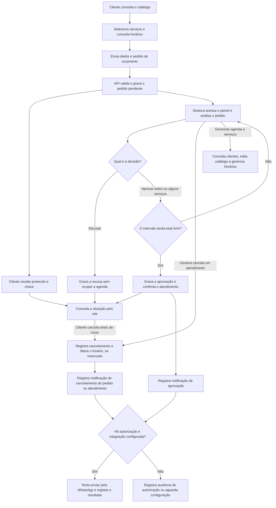

# 4. Tecnologias, fluxo e dados

O site do Studio Tatiane Carrara facilita o gerenciamento de agendamentos e automatiza as etapas de atendimento que podem ser feitas online. A cliente consulta serviços, horários e o andamento do pedido. A gestora decide quais serviços aprovar e administra os horários confirmados e bloqueados.

## Tecnologias escolhidas

| Tecnologia do enunciado | Uso no projeto | Por que foi escolhida |
| --- | --- | --- |
| HTML5 — obrigatório | Estrutura catálogo, calendário, formulários, acompanhamento e painel. | Elementos nativos como formulários, botões e diálogos dão estrutura às telas e apoio à navegação por teclado. |
| CSS3 com Bootstrap 5.3.9 — obrigatório | O Bootstrap fornece a grade responsiva e classes para botões, formulários e espaçamento. O CSS próprio define cores, cartões e calendário. | A grade adapta as telas a celulares e computadores. O CSS próprio mantém a identidade visual do Studio. O projeto usa o CSS distribuído pelo Bootstrap e dispensa uma etapa local de compilação Sass. |
| JavaScript / TypeScript — obrigatório | O JavaScript executa a interface no navegador e as regras na API. | Módulos JavaScript atendem aos dois ambientes e permitem reaproveitar cálculos de preço e duração sem uma etapa de compilação TypeScript. |
| React, Angular ou Vue — opcional | O site usa JavaScript nativo para renderizar e atualizar a interface. | Os formulários e o calendário podem usar diretamente os recursos do navegador, com menos dependências para manter. |
| Banco de dados — opcional | SQLite no desenvolvimento e Cloudflare D1 configurado para hospedagem. Ambos usam as migrações SQL do projeto. | Tabelas representam os dados de forma estruturada. Transações e gatilhos protegem a agenda contra sobreposições, inclusive em aprovações concorrentes. |
| Node.js, Express ou similar — opcional | Node.js executa o servidor local, os testes e o build. O servidor usa o módulo HTTP nativo. O build gera um Worker para a hospedagem. | O ambiente local roda a API e o SQLite sem instalar um framework de servidor. |
| Consumo de APIs REST — opcional | O navegador usa `fetch` para chamar a API HTTP do site e trocar dados em JSON. O servidor pode consumir a API REST do WhatsApp da Meta. | A mesma API aplica as validações para as telas da cliente e da gestora. A integração externa automatiza avisos de aprovação e cancelamento quando configurada. |

O projeto é web. Os requisitos de C#, Windows Forms e WPF constam na seção de aplicações desktop do enunciado. O repositório registra que nenhum protótipo Figma foi produzido. O enunciado da imagem sugere um fluxograma para explicar o funcionamento.

## Como as tecnologias trabalham juntas

| Função | O que acontece da tela ao banco |
| --- | --- |
| Consultar catálogo e horários | HTML e CSS apresentam serviços, preços e calendário. O JavaScript soma a duração da seleção e solicita os horários à API. A API combina expediente, duração total e intervalos confirmados ou bloqueados no banco para devolver os horários disponíveis. |
| Solicitar e acompanhar orçamento | O formulário coleta nome, telefone e autorização de contato. A API valida dados e horário, grava o pedido pendente com os serviços e preços da solicitação e guarda o hash da chave de consulta. A cliente usa protocolo e chave para consultar o resultado. O horário só é reservado após aprovação. |
| Aprovar integral ou parcialmente, ou recusar | O painel HTML recebe a chave administrativa e usa a API para listar pedidos. A gestora decide quais serviços executar. A API recalcula preço e duração com os valores do pedido, grava a aprovação e cria o atendimento na mesma transação. Em caso de sobreposição, o banco rejeita a gravação e o pedido permanece pendente. A recusa registra a decisão sem ocupar a agenda. |
| Administrar agenda, catálogo e clientes | O painel chama a API para registrar e alterar atendimentos, bloquear horários e editar serviços. O catálogo atualizado é salvo em configurações. A lista de clientes é montada a partir dos atendimentos confirmados no período carregado. |
| Cancelar e notificar | A cliente pode cancelar antes do início pelo acompanhamento. A gestora também pode cancelar pelo painel. A API registra o cancelamento, mantém o histórico e, quando havia atendimento confirmado, libera o horário. Nas operações vinculadas a pedido, a notificação segue o consentimento registrado. O envio real via WhatsApp exige conta, credenciais e modelos da Meta. A decisão fica disponível no site mesmo quando a integração está indisponível. |

## Fluxograma da aplicação

## Dicionário de dados

O esquema abaixo corresponde às [três migrações SQL](../drizzle/). Preços são armazenados em centavos. Horários são minutos contados desde meia-noite. A data do atendimento usa `AAAA-MM-DD`, e os registros de criação, decisão e cancelamento usam data e hora em formato ISO. JSON é armazenado em colunas `TEXT`.

| Tabela | Campo | Tipo SQL | Finalidade |
| --- | --- | --- | --- |
| settings | key | TEXT | Chave primária da configuração. |
| settings | value | TEXT | Valor em JSON. A chave `services` guarda o catálogo editável. |
| quotes | id | TEXT | Chave primária e protocolo do orçamento. |
| quotes | token_hash | TEXT | Hash da chave privada de consulta. |
| quotes | date | TEXT | Data solicitada. |
| quotes | start | INTEGER | Início solicitado. |
| quotes | client_name | TEXT | Nome informado pela cliente. |
| quotes | client_phone | TEXT | Telefone informado pela cliente. |
| quotes | services_json | TEXT | Serviços solicitados com os preços e as durações originais. |
| quotes | duration | INTEGER | Duração total solicitada em minutos. |
| quotes | price | INTEGER | Preço total solicitado. |
| quotes | status | TEXT | Decisão do orçamento. Valores `pending`, `approved`, `partial` ou `rejected`. |
| quotes | decision_note | TEXT | Observação da gestora. |
| quotes | created_at | TEXT | Momento do envio. |
| quotes | decided_at | TEXT | Momento da decisão, quando houver. |
| quotes | whatsapp_consent | INTEGER | Indicador de autorização de contato. O valor padrão é `0`. |
| quotes | consent_at | TEXT | Momento do registro da autorização, quando houver. |
| quotes | cancelled_at | TEXT | Momento do cancelamento, quando houver. |
| quotes | cancelled_by | TEXT | Quem cancelou, quando aplicável. |
| quotes | cancellation_reason | TEXT | Motivo registrado para o cancelamento. |
| appointments | id | TEXT | Chave primária do atendimento ou bloqueio. |
| appointments | date | TEXT | Data na agenda. |
| appointments | start | INTEGER | Início do intervalo. |
| appointments | end | INTEGER | Término do intervalo. |
| appointments | kind | TEXT | Tipo de registro. Valores `appointment` ou `block`. |
| appointments | service_id | TEXT | Identificador do primeiro serviço, quando aplicável. |
| appointments | service_name | TEXT | Resumo dos serviços ou descrição do bloqueio. |
| appointments | price | INTEGER | Preço total do atendimento. |
| appointments | client_name | TEXT | Nome da cliente do atendimento. |
| appointments | client_phone | TEXT | Telefone da cliente do atendimento. |
| appointments | status | TEXT | Valores `confirmed` ou `cancelled`. |
| appointments | created_at | TEXT | Momento do registro. |
| appointments | services_json | TEXT | Lista de serviços do atendimento, quando preenchida. |
| appointments | quote_id | TEXT | Protocolo do orçamento de origem, quando houver. O índice único permite um atendimento por orçamento. |
| appointments | cancelled_at | TEXT | Momento do cancelamento, quando houver. |
| appointments | cancelled_by | TEXT | Quem cancelou, quando aplicável. |
| appointments | cancellation_reason | TEXT | Motivo registrado para o cancelamento. |
| notifications | id | TEXT | Chave primária do evento de notificação. |
| notifications | quote_id | TEXT | Orçamento associado, quando houver. |
| notifications | appointment_id | TEXT | Atendimento associado, quando houver. |
| notifications | event | TEXT | Tipo de evento. Valores `approval` ou `cancellation`. |
| notifications | phone | TEXT | Telefone de destino normalizado. |
| notifications | payload_json | TEXT | Conteúdo e parâmetros da mensagem. |
| notifications | status | TEXT | Estado do envio. Valores `pending`, `awaiting_config`, `sending`, `accepted`, `failed`, `unknown`, `skipped_no_consent` ou `superseded`. |
| notifications | attempts | INTEGER | Número de tentativas de envio. |
| notifications | provider_id | TEXT | Identificador retornado pela Meta, quando houver. |
| notifications | error | TEXT | Detalhe sobre falha ou resultado incerto. |
| notifications | created_at | TEXT | Momento da criação da notificação. |
| notifications | updated_at | TEXT | Momento da última atualização. |

`appointments.quote_id` associa um orçamento a até um atendimento. Um bloqueio ou atendimento lançado manualmente pode ter esse campo vazio. Notificações podem apontar para o orçamento, para o atendimento ou para ambos. Esses vínculos são preenchidos pela aplicação. O esquema usa o índice único para `appointments.quote_id` e não declara chaves estrangeiras para esses vínculos.
